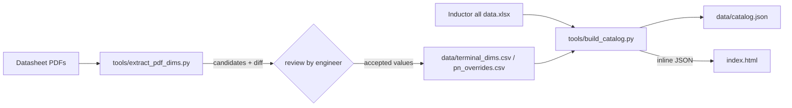

# Part-number auto-resolve: data pipeline

How `index.html` gets its Panasonic part numbers and terminal dimensions, and how
to keep that data correct when datasheets change.



## 1. Sources

### 1.1 Workbook — `Inductor all data.xlsx`, sheet `All Data`

Only the sheet with the flat product list is used. Data starts at row 11; the
header row is row 10.

| Column | Field used |
|---|---|
| B | `catalog` — `〇` marks the web-published (catalogue) part |
| F | `status` (`MP`, …) |
| K | `feature` (LP, LE, HF, …) |
| L | `series` (`4M-KFN`, `AM-JFW`, …) |
| M | `series size` (`PCC-M0648M-LE`) |
| O | part number |
| AB / AC / AD | body `L` / `W` / `H` in mm |

Result: 150 catalogue part numbers, 33 distinct 3-letter suffixes.
The last three characters of the part number (`ETQP4M3R3KFN` → `KFN`) select the
terminal drawing.

### 1.2 Datasheets — `datasheet/*.pdf`

All datasheets live in `datasheet/` (the scripts also still read `*.pdf` from the
project root, and byte-identical copies are skipped with a `skip duplicate` line).

Each collective datasheet contains a **"Dimensions in mm (not to scale)"** page.
Under it, every drawing tile is captioned `PCC-… type` and `(ETQP4M□□□KFN)`.

Field mapping used by this project:

| Field | Drawing feature |
|---|---|
| `P2` | outside span across both terminals (top horizontal dimension) |
| `W1`, `W2` | left / right terminal width |
| `L` | terminal length (depth of the solder terminal) |
| `P1` | **not dimensioned** — derived as `P2 − W1 − W2` |

> Note on the source request: `P1 = P2 − W1 + W2` evaluates to `6.4 mm` for KFN,
> which contradicts the stated `3.2 mm`. The consistent relation used everywhere
> in this project is `W1 + P1 + W2 = P2`, so `P1 = P2 − W1 − W2` (`6.4 − 1.6 − 1.6 = 3.2`).

## 2. Reading the PDF: what is automatic and what is not

The dimension labels are vector text, often rotated, and several drawings share
one page. A fully unattended read is not safe for engineering data, so the
pipeline is split into **extract → review → publish**.

`tools/extract_pdf_dims.py` does:

1. **Find pages** containing `Dimensions in mm`.
2. **Read lines, not blocks** (`page.get_text("dict")`) so every caption keeps its
   own coordinates.
3. **Build tiles**: each `PCC-… type` caption owns the labels that sit
   `30 px` above to the next drawing row, inside `caption_x − 130 … caption_x + 210`.
   Captions within 25 px of each other are treated as one drawing row (some rows
   list two sizes that share one drawing).
4. **Attach suffixes** from the nearest `(ETQP…□□□XYZ)` line, including
   slash aliases such as `YFC/YGC` and `YFK/GAK/YGK`.
5. **Classify** the labels of a tile:
   - `P2` = topmost `±0.4 / ±0.5 / ±0.6` span, preferring the value that matches
     the workbook body length;
   - `W1 = W2` = the `±0.4 / ±0.5` (or plain) value nearest the drawing centre,
     smaller than `P2 / 2`;
   - `L` = the `±0.2 / ±0.3` value nearest the drawing centre;
   - `H` = the `max.` value;
   - `0.05 / 0.1 min.` labels are ignored.
6. **Score** each tile `high / medium / low` and keep the best hit per suffix.
7. **Write** `data/pdf_dim_candidates.csv` and print a **diff** against
   `data/terminal_dims.csv` (`match`, `DIFF - review`, `NEW - needs review`,
   `curated only`).

Current state: **24 suffixes match with zero differences**, plus **16 part-number
rows** for the large-current family. `CVM`, `DTV` (no datasheet on file), `KVC`
(asterisked 1R0 drawing) and `YSC` (suffix not printed on the drawing page) are
resolved from the curated tables only.

### Why a review gate exists

Typical traps the extractor cannot decide alone:

- one drawing serves two sizes (`M0754MS` / `M0854MS`) and the suffix line lists both;
- a suffix has a per-part exception (`ETQP4M1R0KVC` is printed with `*`);
- the same suffix spans two body sizes (`4M-KLC` vs `6M-KLC`);
- the large-current series (`JFA`/`JFW`) specifies the terminal as an `A / B / C`
  table whose width **changes with the inductance**, so those rows are keyed by
  part number, not by suffix.

## 3. Curated tables

### `data/terminal_dims.csv` — one row per suffix

```
suffix,p2,w1,w2,l,h_max,pcb_type,source,status,note
KFN,6.4,1.6,1.6,2.0,4.8,PCC-M0648M-LE,AGL0000C73-LE.pdf p6,verified,
```

`status`: `verified` · `shared-tile` · `review` · `manual`.
Leave `p2/w1/w2/l` empty for `manual` rows.

### `data/pn_overrides.csv` — one row per part number

Wins over the suffix row. Use it when one part inside a family has its own
geometry: `ETQP4M1R0KVC` and `ETQP6M150KLC` (different drawing) plus the 14
`JFA`/`JFW` parts, whose terminal width is tabulated per inductance.

## 4. Publishing

```bash
python3 -m venv .venv
.venv/bin/pip install openpyxl pymupdf      # one-off

.venv/bin/python tools/extract_pdf_dims.py  # extract + diff report
#   review data/pdf_dim_candidates.csv, copy accepted values into
#   data/terminal_dims.csv (or data/pn_overrides.csv)

.venv/bin/python tools/build_catalog.py     # rebuild data/catalog.json + index.html
.venv/bin/python tools/build_catalog.py --check   # CI: fail if index.html is stale
```

`build_catalog.py` writes `data/catalog.json` **and** replaces the block between

```js
/* BEGIN GENERATED CATALOG */
window.PCC_CATALOG = {…};
/* END GENERATED CATALOG */
```

inside `index.html`. The catalog is inlined on purpose: `index.html` must stay a
single, offline, e‑mail-able file (no `fetch`, no CORS problem on `file://`).

### Catalog schema

```json
{
  "generated": "2026-10-23",
  "suffixes": { "KFN": { "p2": 6.4, "w1": 1.6, "w2": 1.6, "l": 2.0,
                          "h_max": 4.8, "pcb_type": "PCC-M0648M-LE",
                          "source": "AGL0000C73-LE.pdf p6",
                          "status": "verified", "note": "" } },
  "parts": [ { "pn": "ETQP4M100KFN", "suffix": "KFN", "series": "4M-KFN",
               "size": "PCC-M0648M-LE", "feature": "LE (Low Price)",
               "state": "MP", "body_l": 6.4, "body_w": 6.0, "body_h": 4.8,
               "dims": { … }, "dims_basis": "suffix | pn-override | none" } ]
}
```

## 5. Deliberately manual

| Suffix | Reason |
|---|---|
| `CVM` | LL series datasheet not in the download set |
| `DTV` | THT type, terminal drawing not in the download set |
| `KVC` | the drawing is marked with `✽` (1R0 exemption), handled per part |
| `YSC` | the M105xMS family shares one drawing; only P1 1.8 / L 7.3 confirmed |

For `CVM` and `DTV`, `P2` still resolves from the workbook body length (7.90 and
14.00) and the UI shows an amber note asking for `W1`, `W2`, `L` by hand.

## 6. UI behaviour in `index.html`

- **Part-number combobox** — all 150 catalogue parts, filter-as-you-type on the
  full part number or on the suffix, arrow keys + <kbd>Enter</kbd>, <kbd>Esc</kbd> closes.
  Picking a suggestion (or pressing <kbd>Enter</kbd> on a resolved number) applies
  the datasheet values immediately.
- **Auto resolve button** — re-applies the values for whatever is in the box,
  and turns blue-tinted while a typed part number has not been resolved yet.
- **Grey advice text** — shown before any selection; replaces itself with a blue
  provenance chip (`Suffix KFN · PCC-M0648M-LE · verified · AGL0000C73-LE.pdf p6`)
  or an amber warning when the drawing is missing.
- **Solver** — there is no mode switch. Three groups exist: `W1 + W2`, `P1`, `P2`.
  As soon as two of them have values, the third is calculated and the field is
  tagged **solved** above the input, with the formula shown underneath:

  | Known | Calculated |
  |---|---|
  | `W1 + W2`, `P2` | `P1 = P2 − W1 − W2` |
  | `W1 + W2`, `P1` | `P2 = W1 + P1 + W2` |
  | `P1`, `P2` | `W1 = W2 = (P2 − P1) / 2` |

  Typing into the solved field hands the calculation to another field (the two
  most recently edited groups are kept), so the relationship can never drift.
- The existing `< 0.03 mm` mismatch card is unchanged; it is skipped while the
  Panasonic row is still incomplete.

## 7. Adding a new datasheet

1. Drop the PDF in `datasheet/`.
2. Run `tools/extract_pdf_dims.py`; check the diff table.
3. Copy validated values into `data/terminal_dims.csv` (or `pn_overrides.csv`),
   cite the file and page in `source`.
4. Run `tools/build_catalog.py`; reload `index.html`.
